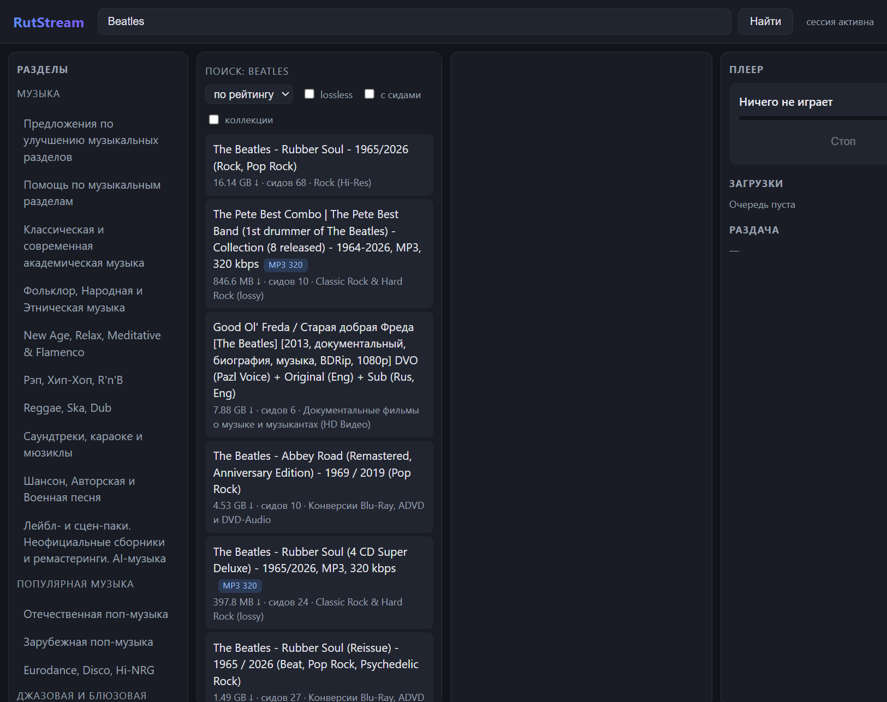

# RutStream

**Десктопное приложение для музыки с rutracker.org: каталог, потоковое воспроизведение и загрузка через BitTorrent.**

Главная идея — **качается не раздача, а только выбранный трек**. Из релиза на 960 МБ вы
нажимаете «play» на одном треке — и по сети идёт ~22 МБ. Остальное не скачивается
и не пишется на диск.

> Desktop app for rutracker.org music: browse, stream and download over BitTorrent.
> Only the selected track is transferred — not the whole release.



> **Проект не связан с rutracker.org.** Это сторонний клиент для личного
> использования. Раздачи на rutracker приватные: скачать их может только
> участник, а публикация защищённых материалов без разрешения правообладателей
> нарушает закон. Пользователь сам отвечает за то, что скачивает, и за
> соблюдение прав правообладателей.

---

## Что умеет

| | |
|---|---|
| **Потоковое воспроизведение** | трек играет, пока качается; остановка в любой момент |
| **Выборочная загрузка** | по треку, альбому или всей дискографии; лишние куски не качаются |
| **0 байт на SSD** | режим `ram`: данные трека живут в оперативной памяти и освобождаются после проигрывания |
| **Однофайловые релизы** | альбом одним FLAC с cue-разметкой разбирается на треки (`FLAC (image+.cue)`) |
| **Каталог** | дерево разделов, поиск, сортировка, фильтры (lossless / с сидами / коллекции), бейджи качества |
| **Страница исполнителя** | все релизы по альбомам + похожие исполнители раздела |
| **Рейтинг раздачи** | счётчики «скачано / раздано» и предупреждение, если рейтинг падает |
| **Очередь загрузок** | прогресс, скорость, отмена |

## Требования

* Windows 10/11 (x64) с WebView2 Runtime (в Windows 11 он уже установлен).
* Go 1.27+ — только для сборки из исходников. Готовый `.exe` собирать не нужно.
* Edge или Chrome — приложение само запускает **скрытый headless-браузер**, когда
  сайт просит пройти проверку Cloudflare. Окно браузера при этом не появляется.

## Быстрый старт

### 1. Скачать готовый exe

Откройте [Releases](https://github.com/mixa7498/RutStream/releases) и скачайте
`rutstream.exe`. Это один самодостаточный файл: интерфейс, сервер и плеер внутри.
Запустите его двойным щелчком — консоль не откроется.

Собрать самому можно одной командой (без PowerShell и без внешних скриптов):

```sh
./build.sh          # собрать и подписать
./build.sh --no-sign # только собрать
```

### 2. Авторизоваться на rutracker

1. Откройте `rutracker.org` в обычном браузере и войдите.
2. Нажмите `F12` → **Application** → **Cookies** → `https://rutracker.org`.
   Найдите `bb_session` и скопируйте её **Value** — значение вида
   `0-12345678-AbCdEf…`.
3. В приложении нажмите **«Сессия»**, вставьте только это значение и сохраните.

`bb_session` помечена **HttpOnly**, поэтому `document.cookie` её не показывает —
копировать нужно именно из таблицы cookie в DevTools.

Сессия хранится только на вашем компьютере, в `%APPDATA%\RutStream\session.cookie`,
и никуда не отправляется. Пароль приложению не нужен. Cloudflare-cookie
(`cf_clearance`) копировать не нужно: скрытый браузер получает её сам.

### 3. Запустить

Двойной щелчок по `rutstream.exe`. Или из консоли:

```sh
rutstream.exe gui
```

Окно браузера при работе **не открывается**. Если rutracker отвечает проверкой
Cloudflare, приложение незаметно поднимает headless Edge без окна и без значка
в панели задач. Пока сайт отвечает напрямую, браузер вообще не запускается.

## Командная строка

```sh
rutstream.exe gui                    # приложение с окном (то же, что без аргументов)
rutstream.exe forums                 # дерево разделов
rutstream.exe search "beatles"       # поиск по всему сайту
rutstream.exe show 6917156           # тема, треклист, сиды, размер
rutstream.exe plan 6917156           # что и сколько скачается при выборе трека
rutstream.exe play 6917156 3         # потоковое воспроизведение трека №3
rutstream.exe download 6917156 3     # скачать трек на диск
rutstream.exe download 6917156 album # скачать альбом
rutstream.exe download 6917156 all   # скачать всю раздачу
rutstream.exe history                # история прослушиваний
rutstream.exe check                  # диагностика доступа к сайту
rutstream.exe raw /forum/index.php out.html   # сырой HTML (отладка парсеров)
```

Переменные окружения:

| Переменная | Назначение |
|---|---|
| `RUTSTREAM_COOKIE` | значение `bb_session` (для совместимости — полная строка cookie) |
| `RUTSTREAM_USER` / `RUTSTREAM_PASS` | логин и пароль (альтернатива cookie) |
| `RUTSTREAM_STORAGE` | `ram` — без записи на SSD; `disk` — по умолчанию |
| `RUTSTREAM_MEM_LIMIT_MB` | лимит памяти в режиме `ram` (по умолчанию 512) |
| `RUTSTREAM_MIN_RATIO` | минимальный рейтинг раздачи (по умолчанию 0.5) |
| `RUTSTREAM_PROXY` | `socks5://host:port` — и для сайта, и для пиров |
| `RUTSTREAM_NO_BROWSER` | не запускать даже скрытый браузер (часть страниц будет недоступна) |
| `RUTSTREAM_BROWSER_VISIBLE` | `1` — показать окно браузера (только для отладки) |
| `RUTSTREAM_CDP_PORT` | порт отладки скрытого браузера (по умолчанию 9222) |
| `RUTSTREAM_DATA` | каталог данных (по умолчанию `%APPDATA%\RutStream`) |

## Как это работает

```
┌────────────┐  CDP (Edge)   ┌──────────────┐   piece-план    ┌──────────────┐
│  rutracker │◄──────────────►│  поиск, темы │─────────────────►│  mediaindex  │
│  .org      │                │  .torrent    │                  │  треки, границы│
└────────────┘                └──────────────┘                  └──────┬───────┘
                                                                       │
┌────────────┐   выборочные   ┌──────────────┐   PCM     ┌───────────┐ │
│  пиры      │◄──piece'ы──────►│  anacrolix   │──────────►│  декодер  │─┼──► звук
│  (P2P)     │                 │  + RAM-Store │           └───────────┘ │
└────────────┘                 └──────────────┘                            │
                                                                         ▼
                                                                  локальный диск
                                                                  (в режиме ram — нет)
```

1. **Транспорт.** Cloudflare проверяет TLS-отпечаток клиента, поэтому «скопированная»
   cookie не всегда работает. Если прямой запрос упирается в проверку, приложение
   незаметно запускает headless Edge (без окна) и выполняет запросы в нём — проверка
   проходит как для обычного пользователя. Браузер живёт только пока нужен, и
   закрывается вместе с приложением.
2. **Индекс.** По названию раздачи и треклисту с сайта сопоставляются файлы торрента;
   для однофайловых релизов заголовок файла читается на лету (это инициирует
   докачку нужного куска) и разбирается cue-файл.
3. **План.** Считается, какие piece'ы покрывают нужный трек. Остальные не запрашиваются.
4. **Поток.** Файл читается подряд, декодер отдаёт PCM в звуковую карту; незавершённый
   трек обрывается по достижении нужного объёма — дальше файл не читается, и
   торрент-клиент не качает следующие куски.

Подробности разработки и найденные по пути грабли — в [STATUS.md](STATUS.md)
и [BUILD.md](BUILD.md).

## Подпись приложения

Без подписи Windows Smart App Control может блокировать запуск неподписанных
бинарников. Самоподписанный сертификат снимает предупреждение «неизвестный
издатель» на машинах, где его установят:

```sh
./build.sh              # сборка + подпись, сертификат создаётся сам
```

Сертификат создаётся рядом с бинарником: `rutstream/bin/rutstream-cert.cer`.
Чтобы Windows ему доверяла, установите его один раз из cmd от администратора:

```bat
certutil -addstore Root "rutstream\bin\rutstream-cert.cer"
certutil -addstore TrustedPublisher "rutstream\bin\rutstream-cert.cer"
```

Для распространения публично нужна подпись публичным удостоверяющим центром —
подробности и варианты в [BUILD.md](BUILD.md#подпись).

## Ограничения

* **Аккаунт rutracker** с действующей сессией: без неё недоступны закрытые разделы.
* Если сайт просит капчу, которую headless-браузер не проходит автоматически,
  можно один раз запустить его с окном: `RUTSTREAM_BROWSER_VISIBLE=1`.
* **Приватные трекеры** rutracker отдают пиров только участникам раздачи.
* Часть треков внутри альбома требует скачать данные до их начала — формат FLAC
  не позволяет начать с произвольного места (см. STATUS.md).
* **Smart App Control** на Windows блокирует неподписанные бинарники: либо
  подпишите приложение (см. [BUILD.md](BUILD.md#подпись)), либо отключите политику
  в «Параметры Windows → Безопасность Windows».

## Разработка

```sh
cd rutstream
go test ./...                 # все тесты
go test -race ./...           # с проверкой гонок
go build -tags nodevice ./... # сборка без звуковой карты (CI, Linux)
```

Структура:

```
rutstream/internal/rutracker/   работа с сайтом: клиент, браузерный транспорт, парсеры
rutstream/internal/torrent/      BitTorrent-движок: выбор piece'ов, RAM-хранилище
rutstream/internal/mediaindex/   индекс треков: piece-математика, sniffer'ы, cue-разметка
rutstream/internal/audio/        декодирование FLAC/MP3, вывод в звуковую карту
rutstream/internal/playback/     оркестратор «трек → куски → звук»
rutstream/internal/gui/          локальный сервер с JSON-API и встроенный фронтенд
rutstream/internal/download/     очередь загрузок, Ratio Guard
rutstream/internal/catalog/      SQLite: разделы, треки, история
```

## Лицензия

MIT — см. [LICENSE](LICENSE).
